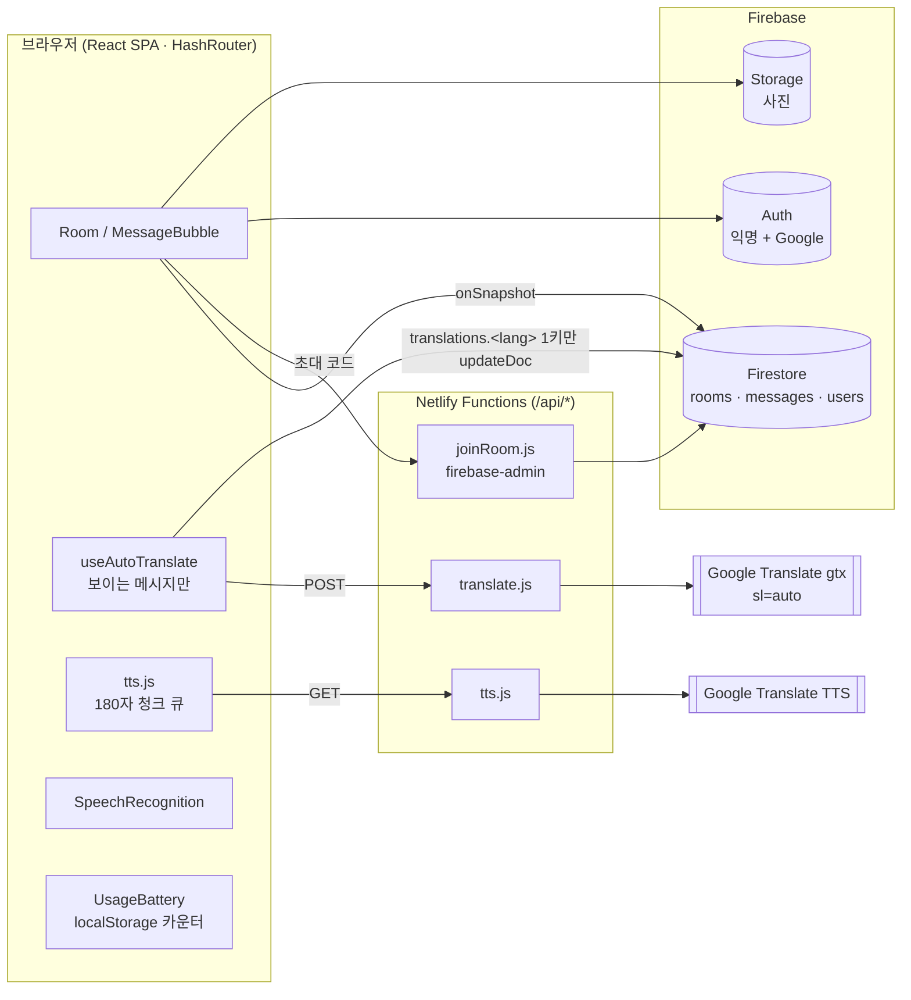

# 기술 스택 — 말.통 (MAL.TONG)

> **한 줄 요약** — React SPA 가 Firestore 를 실시간 구독하고, 보이는 메시지만 Netlify Function 으로 **감지+번역을 한 번에** 받아 Firestore 에 언어 키 하나씩 되돌려 쓰는(번역 캐시) 서버리스 다국어 채팅.
>
> **최종 수정: 2026-10-18** · 머신 판독용 원본은 [`techstack.json`](./techstack.json) (앱의 설정 > 앱 정보에서도 보임)

---

## ① 아키텍처

**핵심 흐름** — 메시지 전송 시 `detectedLang` 은 비워 둔다 → 처음 본 사람이 `sl=auto` 로 번역하면서 감지 결과를 1회 기록 → 같은 언어의 다음 사람은 `translations[내 언어]` 를 그냥 읽는다.

---

## ② 카테고리별 구성

### 프론트엔드
| 이름 | 버전 | 용도 | 위치 | 비고 |
|---|---|---|---|---|
| React | 19.3.1 | UI | `src/` | 말풍선 `React.memo` + 시그니처 비교 |
| Vite | 7.3.7 | 개발 서버·번들 | `vite.config.js` | 개발 중 Functions 를 미들웨어로 실행 |
| react-router-dom | 7.18.4 | 라우팅 | `src/App.jsx` | **HashRouter** (초대 링크 404 방지) |
| Tailwind CSS | 3.4.19 | 스타일 | `tailwind.config.js`, `src/index.css` | 공통 클래스는 `@layer components` |
| PostCSS / Autoprefixer | 8.5.30 / 10.6.1 | CSS 빌드 | `postcss.config.js` | |
| lucide-react | 1.59.0 | 아이콘 | — | |
| Pretendard · Outfit | 1.3.9 / — | 폰트 | `index.html` | jsDelivr · Google Fonts CDN |

### 백엔드 (서버리스)
| 이름 | 버전 | 용도 | 위치 | 비고 |
|---|---|---|---|---|
| Netlify Functions | ESM·esbuild | 번역·TTS 프록시, 초대 입장 | `netlify/functions/` | `/api/*` 리다이렉트 |
| firebase-admin | 13.10.0 | 비멤버 초대 코드 조회 + 멤버 추가 | `netlify/functions/joinRoom.js` | `FIREBASE_SERVICE_ACCOUNT` 필요 (에뮬레이터 모드 제외) |

### 데이터·스토리지
| 이름 | 용도 | 위치 | 비고 |
|---|---|---|---|
| Cloud Firestore | users / rooms / messages | `firestore.rules`, `firestore.indexes.json` | `translations`·`pronunciations` 인덱스 끔 (쓰기 비용) |
| Firebase Storage | 사진 | `storage.rules` | 1600px JPEG 축소, 5MB 제한. **아직 미활성** (Blaze 필요) |
| localStorage | 설정 사본·자주 쓰는 문구·사용량 카운터 | `src/context/SettingsContext.jsx` 등 | |

### 인증·접근제어
| 이름 | 용도 | 위치 | 비고 |
|---|---|---|---|
| Firebase Auth 익명 | 가입 없는 게스트 | `src/context/AuthContext.jsx` | `browserLocalPersistence` 명시 |
| Firebase Auth Google | 로그인 · 익명 승격 | 〃 | `linkWithPopup` 으로 UID 유지 |
| Firestore 규칙 | 멤버만 읽기, 번역 키는 누구나 | `firestore.rules` | "작성자만 수정"이면 번역 캐시가 전부 실패 |
| Storage 규칙 | 방 멤버만 읽기·업로드, 덮어쓰기·삭제 금지 | `storage.rules` | `firestore.get()` 교차 서비스 규칙 — 익명 로그인은 누구나 하므로 "로그인 여부"만으론 부족 |

### AI·외부 API
| 이름 | 용도 | 위치 | 비고 |
|---|---|---|---|
| Google Translate `gtx` | 감지 + 번역 + 발음 1회 호출 | `netlify/functions/translate.js` | **비공식**. 교체 지점은 이 파일 하나 |
| Google Translate TTS | 음성 합성 | `netlify/functions/tts.js`, `src/lib/tts.js` | 요청당 ~200자 → 180자 청크 |
| speechSynthesis | TTS 폴백 | `src/lib/tts.js` | `languages.js` 의 `speech` 로케일 |
| SpeechRecognition | 음성 입력 · 대면 통역 | `src/lib/speech.js` | Firefox 미지원 → 버튼 숨김 |

### CORS · 호스팅 · 배포
| 이름 | 용도 | 위치 |
|---|---|---|
| Firebase 프로젝트 `multi-language-chat-52528` | 소유자 개인 계정·조직 | `.env`, `.firebaserc` |
| Functions 프록시 | gtx 직접 호출 시 CORS 차단 회피 | `netlify.toml` |
| Netlify | 정적 사이트 + Functions | `netlify.toml` |
| `npm run build` → `netlify deploy --prod` | 앱 배포 | — |
| `npm run deploy:rules` | 규칙·인덱스 배포 | `firebase.json` |

### 개발 환경
| 이름 | 버전 | 용도 | 위치 |
|---|---|---|---|
| Vite Functions 미들웨어 | — | `npm run dev` 만으로 `/api/*` 동작 | `vite.config.js` |
| Firebase Emulator Suite | firebase-tools 15.19.0 | `npm run dev:local` — 실제 프로젝트 없이 Auth·Firestore·Storage 로컬 실행 | `firebase.json`, `.env.emulator`, `scripts/dev-local.sh` |
| OpenJDK | 26 (Homebrew) | 에뮬레이터 실행 | `brew install openjdk` |

### 운영 가시성(Observability)
| 이름 | 용도 | 위치 | 비고 |
|---|---|---|---|
| 서버 용량 신호등 | 우측 하단 배터리. 무료 한도 대비 사용률 추정 | `src/components/UsageBattery.jsx`, `src/lib/usage.js` | 40/70/90% · ok `#43a047` warn `#fbc02d` danger `#f57c00` critical `#e53935` |
| fetch 카운터 | `/api/` 호출 자동 집계 | `installFetchCounter()` | 이중 패치 가드 |

---

## ③ 왜 이걸 골랐나

- **gtx `sl=auto`** — 감지와 번역이 한 응답에 같이 온다(`data[2]`). 감지 전용 호출이 없으니 비용이 늘지 않고, "보낸 사람 설정 = 원문 언어" 버그를 구조적으로 막는다.
- **번역을 Firestore 에 되돌려 쓰기** — 같은 언어 사용자가 여럿이면 번역 요청은 첫 사람 1회뿐. 점 표기법으로 키 하나만 써서 다른 언어 번역을 덮지 않는다.
- **HashRouter** — 호스팅 rewrite 설정과 무관하게 초대 링크가 열린다.
- **익명 인증 + joinRoom Function** — 가입 없이 들어오되, 초대 코드 조회는 서버(Admin SDK)에서만 해서 방 목록 열람 취약점을 만들지 않는다.
- **Netlify + Firebase 무료 티어** — 전 구간 0원 운영이 목표.
- **에뮬레이터 모드** — 실제 프로젝트를 만들기 전에도 전체 흐름(입장·번역 캐시·규칙)을 로컬에서 검증할 수 있다. `demo-` 프로젝트는 실제 클라우드에 닿지 않는다.

---

## ④ 외부 의존 서비스 — 헬스·요금 영향

| 서비스 | 무료 한도 | 초과·장애 시 증상 | 앱의 대응 | 유료 대안 |
|---|---|---|---|---|
| Google Translate `gtx` | 공식 한도 없음 | 429 / 차단 → 번역 실패 | 429 는 1회 백오프 재시도, 실패 시 **원문 표시** | Cloud Translation API (월 50만자 무료) |
| Google Translate TTS | 〃 | 502 | `speechSynthesis` 폴백 | Cloud TTS |
| Firestore 읽기 | 50,000/일 | 메시지가 안 보임 | 신호등 경고, 최근 200건만 구독 | Blaze |
| Firestore 쓰기 | 20,000/일 | 전송·번역 저장 실패 | 저장 실패해도 화면엔 번역 표시 | Blaze |
| Netlify Functions | 125,000회/월 | 번역·TTS 정지 | 신호등 경고, TTS `max-age=86400` CDN 캐시 | Netlify Pro |
| Netlify 대역폭 | 100GB/월 | 사이트 정지 | — | Netlify Pro |
| Firebase Storage | 5GB 저장 · 1GB/일 다운로드 | 사진 업로드·표시 실패 | 업로드 전 압축 | Blaze |

---

## ⑤ 알려진 한계

- **`client=gtx` 는 비공식 엔드포인트**라 언제든 막힐 수 있다. 막히면 번역이 조용히 실패하고 원문이 보인다 → `translate.js` 한 파일만 공식 API 로 바꾸면 된다.
- **신호등은 추정치** — 이 브라우저에서 발생한 호출만 센다. 다른 사용자·기기의 사용량은 반영되지 않으며, Storage 바이트·Functions 대역폭은 아직 집계하지 않는다.
- **4자 미만 짧은 문장**은 감지가 부정확해 보낸 사람 설정 언어를 우선하고 뱃지에 `?` 를 단다(탭해서 교정).
- **2000자 초과 메시지**의 번역은 문서 1MB 방어를 위해 Firestore 에 저장하지 않고 세션 메모리에만 둔다 → 보는 사람마다 매번 번역 요청이 나간다.
- **음성 인식**은 Chrome/Edge/Safari 에서만 동작하고 iOS Safari 는 불안정하다. 대면 통역은 미지원 브라우저에서 텍스트 입력으로 대체된다.
- **방 이름·초대 코드 충돌 검사 없음** — 36⁸ ≈ 2.8조 공간 + 암호학적 난수에 기대고, 생성 시 중복 조회는 하지 않는다(비멤버 조회가 규칙상 불가).
- 에뮬레이터 모드는 Java 가 필요하다(`brew install openjdk`).
- **Firebase Storage 미활성** — 2024-10 이후 새 기본 버킷은 Blaze 요금제가 필요하다. 활성화 전에는 `.env` 의 버킷 값을 비워 두어 사진 버튼을 숨긴다.
- **서비스 계정 키** — 소유 조직은 `iam.disableServiceAccountKeyCreation` 을 강제하고, **이 프로젝트만 예외**로 풀어(2026-10-18) joinRoom 용 키(`firebase-adminsdk-fbsvc`)를 발급했다. 키 파일은 로컬 `service-account.json`(gitignore), 배포 환경은 Netlify 환경변수 `FIREBASE_SERVICE_ACCOUNT`. 유출되면 콘솔 > IAM > 서비스 계정 > 키에서 즉시 삭제하고 재발급한다.
