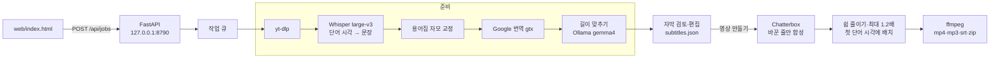

# 기술 스택 — 말.통 더빙 (로컬 도구)

> **한 줄 요약** — 유튜브 링크 하나로 원래 목소리 그대로 6개 언어 더빙 영상·음성·자막을 만드는 로컬 웹 도구. 음성 인식·목소리 합성이 전부 이 Mac 에서 돈다.
>
> **최종 수정: 2026-10-21** · 머신 판독용 원본은 [`techstack.json`](./techstack.json) (더빙 화면 아래 "기술 스택"에서도 보임)

---

## ① 아키텍처

**시각 맞추기** — Whisper 문장은 앞 문장이 끝난 시각에 시작하는 경우가 많아(실측: 0.00초 → 실제 말은 1.58초) 그대로 쓰면 더빙이 먼저 나온다. 단어 시각으로 첫 단어가 들리는 시각을 시작으로 삼는다. 번역이 길면 로컬 AI 가 시간에 맞게 줄이고, 합성 결과의 긴 쉼을 줄이고, 그래도 넘치면 최대 1.2배까지만 빠르게 한 뒤 다음 문장을 민다. 실측(49초 영상): 예전 중국어 10/11줄 1.4배·최대 11.8초 밀림 → 영어 최대 0.2초, 중국어는 짧은 줄 연속 구간만 밀리고 7번째 줄부터 원래 시각.

**HTTPS 검사 네트워크** — 회사·보안 프로그램(Somansa 등)이 HTTPS 를 중간에서 검사하면 Python 기본 인증서 목록(certifi)이 그 인증서를 몰라 유튜브·번역·모델 내려받기가 모두 실패한다. `truststore` 로 운영체제(Mac 키체인) 인증서 저장소를 쓰게 한다 (`dubber/__init__.py`) — 검증을 끄지 않는다.

**고정 버전 주의** — `chatterbox-tts 0.1.7` 이 `torch 2.6.0`·`transformers 5.2.0` 을 고정한다. `setuptools<81` 이 없으면 워터마크(resemble-perth)가 `pkg_resources` 를 못 불러 모델이 뜨지 않는다.

---

## ③ 왜 이걸 골랐나

- **Chatterbox Multilingual** — 오픈소스(MIT)이고 견본 10~20초로 목소리를 흉내 내며 요청한 6개 언어(영·중·일·스·독·불)를 모두 지원한다. 원본 노트북(Colab)과 같은 모델.
- **MLX Whisper** — Apple Silicon 에서 가장 빠른 로컬 Whisper. 모델이 이미 이 Mac 에 캐시돼 있었다.
- **gtx 번역** — 말.통 본체와 같은 무료 경로. 문장 하나씩 보내 시간축과 1:1 로 맞춘다(묶어 보내면 줄이 합쳐져 어긋난다).
- **로컬 웹 + 127.0.0.1** — 더빙은 GPU 를 수십 분 쓰므로 Netlify 같은 서버리스에서는 돌 수 없다. 목소리 복제 도구라 외부 접속을 막았다.
- **Colab 전용 우회 코드 제거** — 원본 노트북의 Python 3.13·transformers 패치와 강제 재시작은 고정된 3.11 환경에서 필요 없다.

---

## ④ 외부 의존 서비스 — 헬스·요금 영향

| 서비스 | 비용 | 장애 시 증상 | 대응 |
|---|---|---|---|
| YouTube / yt-dlp | 0원 | 내려받기 실패(유튜브 변경) | `uv pip install -U yt-dlp -p dubbing/.venv/bin/python` |
| Google 번역 gtx | 0원 (비공식) | 429·차단 → 번역 실패 | 점점 길게 쉬었다 5회 재시도, 실패 문장은 원문 |
| Hugging Face (모델 받기) | 0원 | 첫 실행 때만 필요 | 이후 캐시 사용 |

---

## ⑤ 알려진 한계

- **느리다** — MacBook Air M4 16GB 실측: 30초 영상 × 2개 언어 = 12분 (영상 1분·언어 하나 ≈ 8~12분, 합성 RTF ≈ 3~8). 팬이 없어 오래 돌리면 열 때문에 느려진다. 긴 영상은 "앞부분만"으로 나누거나 CUDA GPU(Colab T4 등)가 빠르다.
- **Chatterbox 보정 4가지** (`dubber/tts.py`) — ① 문장마다 attention hook 이 쌓여 점점 느려지는 0.1.7 버그를 떼어 냄 ② 글자 토큰 5개 이하의 아주 짧은 문장("Is it B1?")에서 반복 검사가 빈 구간에 max() 를 해 멈추는 버그 — 문장이 끝난 상태이므로 원래처럼 끝(EOS)을 낸다 ③ 가끔 문장 앞뒤에 붙는 알아들을 수 없는 말을 Whisper 로 다시 받아써 찾아내고 최대 3번 다시 만든다 (숫자 표기 차이는 다시 만들지 않음) ④ 가끔 아주 느리게 읽는 문장(중국어 7글자에 3.8초)은 예상 길이의 1.6배를 넘으면 다시 만들고, 내용이 맞는 것 중 가장 짧은 것을 쓴다.
- **Colab 노트북** — 의존성(리눅스용 해석)·셀 문법·openai-whisper 경로·파일 입력은 이 Mac 에서 확인했지만, Colab 에서 처음부터 끝까지 돌려 보지는 못했다. 유튜브는 Colab 같은 서버 IP 의 내려받기를 자주 막아 영상 파일 올리기로 넘어갈 수 있다.
- **실행 파일은 macOS 용** — Windows 는 `requirements-gpu.txt` 로 설치는 되지만 실행 파일(.bat)은 아직 없다.
- **배경음 없음** — 더빙 영상은 원래 소리를 더빙으로 바꾼다(음악·효과음도 빠진다). 보컬 분리(demucs 등)는 아직 없다.
- **짧은 줄이 연달아 나오는 구간** — 줄마다 숨·끝맺음 시간(약 0.6초)이 있어 짧은 대화가 빠르게 이어지면 1.2배로도 못 맞춰 몇 초 밀릴 수 있다. 편집 화면에서 줄이거나 합치면 된다.
- **AI 로 줄인 번역** — 뜻은 대체로 지키지만 가끔 정보가 빠진다(예: "지하 1층인가?" → "Basement?"). 검토 화면에서 확인하는 것을 권한다.
- **용어 교정은 한국어 원문만** — 다른 언어 원문은 찾아 바꾸기로 고친다.
- **목소리 견본 품질** — 영상 속 배경음악이 크면 견본에 섞여 결과가 탁해진다. 그럴 땐 깨끗한 내 목소리 파일을 올린다.
- **문장 단위 번역** — 문장마다 따로 번역해 앞뒤 맥락을 못 본다.
