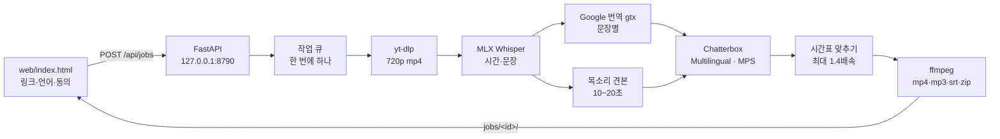

# 기술 스택 — 말.통 더빙 (로컬 도구)

> **한 줄 요약** — 유튜브 링크 하나로 원래 목소리 그대로 6개 언어 더빙 영상·음성·자막을 만드는 로컬 웹 도구. 음성 인식·목소리 합성이 전부 이 Mac 에서 돈다.
>
> **최종 수정: 2026-10-20** · 머신 판독용 원본은 [`techstack.json`](./techstack.json) (더빙 화면 아래 "기술 스택"에서도 보임)

---

## ① 아키텍처

**시간 맞추기** — 문장 i 의 더빙을 원래 시작 시각에 놓고, 다음 문장 전까지 못 끝나면 음높이를 유지한 채 최대 1.4배 빠르게 한다. 그래도 넘치면 다음 문장을 뒤로 밀고, 쉬는 구간에서 다시 원래 시각을 따라잡는다. 번역 자막은 더빙이 실제로 나오는 시각에 맞춘다.

---

## ② 카테고리별 구성

| 분류 | 이름 | 버전 | 용도 | 위치 |
|---|---|---|---|---|
| 프론트 | 단일 HTML | — | 입력·진행률·미리보기·내려받기 | `web/index.html` |
| 백엔드 | Python | 3.11 | Chatterbox 가 시험된 버전 (uv `.venv`) | `run.sh` |
| 백엔드 | FastAPI · Uvicorn | 0.153 · 0.54 | API·정적 페이지 | `server.py` |
| AI(로컬) | Chatterbox Multilingual | 0.1.7 | 목소리 복제 다국어 합성 (MIT) | `dubber/tts.py` |
| AI(로컬) | Whisper large-v3-turbo (MLX) | mlx-whisper 0.4.3 | 음성 인식 + 시각, 합성 결과 재확인 | `dubber/stt.py`, `dubber/tts.py` |
| 외부 | yt-dlp | 2026.8.19+ | 유튜브 내려받기 | `dubber/media.py` |
| 외부 | Google 번역 gtx | — | 문장별 번역 (무료) | `dubber/translate.py` |
| 시스템 | ffmpeg | 8.1 | 추출·정리·배속·합치기 | `dubber/media.py` |
| 시스템 | uv · Apple Silicon | — | 가상환경 · MLX/MPS | — |
| 운영 가시성 | 서버 용량 신호등 | — | 메모리·디스크·CPU 배터리 | `/api/server-health`, `#serverBattery` |

**고정 버전 주의** — `chatterbox-tts 0.1.7` 이 `torch 2.6.0`·`transformers 5.2.0` 을 고정한다. `setuptools<81` 이 없으면 워터마크(resemble-perth)가 `pkg_resources` 를 못 불러 모델이 뜨지 않는다.

---

## ③ 왜 이걸 골랐나

- **Chatterbox Multilingual** — 오픈소스(MIT)이고 견본 10~20초로 목소리를 흉내 내며 요청한 6개 언어(영·중·일·스·독·불)를 모두 지원한다. 원본 노트북(Colab)과 같은 모델.
- **MLX Whisper** — Apple Silicon 에서 가장 빠른 로컬 Whisper. 모델이 이미 이 Mac 에 캐시돼 있었다.
- **gtx 번역** — 말.통 본체와 같은 무료 경로. 문장 하나씩 보내 시간축과 1:1 로 맞춘다(묶어 보내면 줄이 합쳐져 어긋난다).
- **로컬 웹 + 127.0.0.1** — 더빙은 GPU 를 수십 분 쓰므로 Netlify 같은 서버리스에서는 돌 수 없다. 목소리 복제 도구라 외부 접속을 막았다.
- **Colab 전용 우회 코드 제거** — 원본 노트북의 Python 3.13·transformers 패치와 강제 재시작은 고정된 3.11 환경에서 필요 없다.

---

## ④ 외부 의존 서비스 — 헬스·요금 영향

| 서비스 | 비용 | 장애 시 증상 | 대응 |
|---|---|---|---|
| YouTube / yt-dlp | 0원 | 내려받기 실패(유튜브 변경) | `uv pip install -U yt-dlp -p dubbing/.venv/bin/python` |
| Google 번역 gtx | 0원 (비공식) | 429·차단 → 번역 실패 | 점점 길게 쉬었다 5회 재시도, 실패 문장은 원문 |
| Hugging Face (모델 받기) | 0원 | 첫 실행 때만 필요 | 이후 캐시 사용 |

---

## ⑤ 알려진 한계

- **느리다** — MacBook Air M4 16GB 실측: 30초 영상 × 2개 언어 = 12분 (영상 1분·언어 하나 ≈ 8~12분, 합성 RTF ≈ 3~8). 팬이 없어 오래 돌리면 열 때문에 느려진다. 긴 영상은 "앞부분만"으로 나누거나 CUDA GPU(Colab T4 등)가 빠르다.
- **Chatterbox 보정 2가지** (`dubber/tts.py`) — ① 문장마다 attention hook 이 쌓여 점점 느려지는 0.1.7 버그를 떼어 냄 ② 가끔 문장 앞뒤에 붙는 알아들을 수 없는 말을 Whisper 로 다시 받아써 찾아내고 최대 3번 다시 만든다 (숫자 표기 차이는 다시 만들지 않음).
- **Apple Silicon 전용** — mlx-whisper 때문. 다른 컴퓨터는 `faster-whisper` 로 바꿔야 한다.
- **배경음 없음** — 더빙 영상은 원래 소리를 더빙으로 바꾼다(음악·효과음도 빠진다). 보컬 분리(demucs 등)는 아직 없다.
- **긴 번역문** — 원문보다 길게 번역된 문장은 1.4배속으로도 못 맞추면 뒤로 밀려 입 모양·화면과 어긋날 수 있다.
- **목소리 견본 품질** — 영상 속 배경음악이 크면 견본에 섞여 결과가 탁해진다. 그럴 땐 깨끗한 내 목소리 파일을 올린다.
- **문장 단위 번역** — 문장마다 따로 번역해 앞뒤 맥락을 못 본다.
